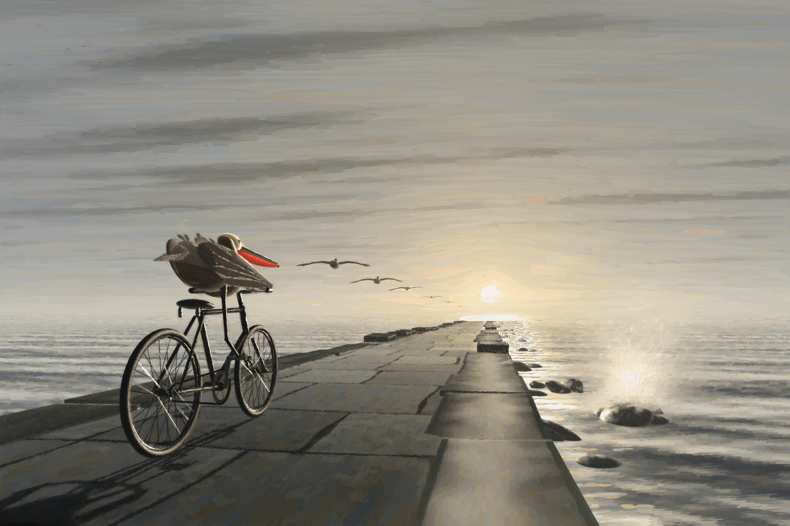

# The Last in the Line

An old brown pelican who can no longer fly rides a bicycle out along a stone breakwater at
sunset, following his flock home.



- Full painting, 4800 × 3200: [`output/pelican-breakwater.jpg`](output/pelican-breakwater.jpg)
- 100% details: [`output/detail-head.jpg`](output/detail-head.jpg), [`output/detail-feet.jpg`](output/detail-feet.jpg)

The picture is painted by a program in this repository. There is no image model and no
photograph anywhere in the process. A small 3D scene is ray-traced into a *reference*, the
image a painter would look at. A simulated brush then paints that reference stroke by stroke
on simulated linen, using four pigments. The renderer is plain Node.js with no dependencies,
and it is deterministic: the same seed always paints the same picture.

## The brief

> Large museum-scale oil painting on linen, 3:2 landscape, seen flat-on, full-bleed, no frame.
> An old brown pelican who can no longer fly rides a bicycle out along a long stone breakwater
> at sunset, following his flock home.
>
> **Viewpoint**: Low, from behind and slightly to the left: a three-quarter rear view, a
> Rückenfigur in the manner of Caspar David Friedrich, so we look past him toward the light.
>
> **Rider**: Aged brown pelican in breeding plumage, anatomically exact: straw-yellow crown, dark
> chestnut nape, silver-streaked gray-brown back, long gray bill in profile, scarlet throat
> pouch glowing against the sun, black webbed feet. He stands on the pedals of an old black
> steel bicycle (two spoked wheels, chain, cranks, rust at the joints), body pitched forward
> almost horizontal, neck drawn back onto his shoulders, the bends of both wings braced on the
> handlebars. His near wing is ragged, its outer flight feathers missing — an old, healed
> injury. The wind lifts the feathers on his back.
>
> **Flock**: Six brown pelicans glide in single file beside the breakwater at the height of his
> head, in exactly his horizontal posture, each smaller, fainter and softer as they recede. The
> breakwater and the line of birds converge on a single vanishing point: the low sun, veiled in
> sea haze, just above the horizon right of center. He is the last bird in the line.
>
> **Light**: Contre-jour. A silver-gold glitter path runs across the water to the sun; the flock
> are dark silhouettes with burning edges; the rider is rim-lit along bill, crown and ragged
> wing, his shadows cooled by skylight. Backlit spray rises from a wave breaking against the
> stones; his long shadow stretches back toward us. Darkest darks and brightest lights meet at
> his head.
>
> **Color**: Zorn palette (yellow ochre, vermilion, ivory black, lead white): pearl, pewter and
> pale gold throughout; the scarlet pouch is the only saturated color.
>
> **Handling**: Winslow Homer's gravity, Anders Zorn's bravura. Sky and sea in broad
> wet-into-wet sweeps and palette-knife drags verging on abstraction; distant birds as single
> calligraphic strokes; the rider's head, bill and feet painted with exacting precision. Heavy
> impasto in the glitter and spray, thin scumbles in shadow with linen showing through,
> lost-and-found edges.
>
> **Not**: human hands, clothing, people, extra limbs, malformed bicycle, text, signature,
> watermark, cartoon, illustration, CGI, airbrushing, HDR, oversaturation.

## Interpretation notes

Some of the brief's requirements could not all hold literally at once. These are the choices
made and the reasons for them.

- **Mirror viewpoint.** The brief asks for a view from behind and slightly to the left. It also
  puts the sun right of center, makes the rider the last bird in a line that converges on the
  sun, and sends his shadow back toward us. With the sun on the right, a viewer on his left
  would see the breakwater run away from the light. So the camera stands behind him and
  slightly to his **right**. The three-quarter rear view and the low Rückenfigur framing stay
  as briefed. We see his back and right flank, so the ragged near wing is his right wing, and
  the chain side of the bicycle faces us.
- **One true perspective.** The scene is a single 3D camera. The eye is 0.62 m above the slabs
  and the lens covers about 74° horizontally. The camera is turned so the breakwater's
  vanishing point falls at 62% of the width. The sun sits 2.2° above that point, so the slab
  joints, the coping stones and the line of birds all converge on it.
- **Flock spacing.** The six gliders sit on the straight line from his crown to the sun.
  Their sizes and gaps shrink geometrically rather than by strict 1/distance, which would
  bunch them into the glare. The last two stay countable as single calligraphic strokes.
- **The shadow.** The sun is straight ahead and only 2.2° up, so the physical shadow would run
  some 25 m back past the viewer as a hairline. The cast shadow is computed from a painter's
  sun at 35°, which keeps the shadow long and pointing back toward us while it stays on the
  slabs.
- **A walled mole.** A sloping rubble breakwater hides the sun's glitter on the water beside it
  from such a low eye. So this is a masonry mole with vertical walls. It has worn granite
  slabs, dressed coping blocks along both edges, and tumbled boulders at the seaward foot,
  where the wave breaks.
- **Standing on the pedals.** A pelican's legs are short. The bicycle is a small 22-inch
  roadster with its saddle dropped low, so he can clear it and stand with his near foot on the
  raised pedal. His body rides forward over the top tube, with the wing bends on the grips.
  The legs are still longer than life, which is the one anatomical licence taken.
- **The pouch.** He has the Pacific race's breeding colours: a white head with a straw-yellow
  crown, a dark chestnut hindneck with a white stripe, and a scarlet pouch. The pouch glows
  when the sun is behind it, and it is the one saturated colour in the picture. The flock's
  pouches stay inside their dark silhouettes.

## How it is made

```
3D scene ──► reference + style maps ──► painting (strokes on linen) ──► finish
```

1. **Scene** (`src/scene/`)
   - The camera, a sky dome and a sea with Fresnel reflection and Cox–Munk sun glitter.
   - The slab walk, shaded analytically per pixel.
   - Analytic ray-traced primitives for the coping stones, the boulders, the bicycle and the
     pelicans: spheres, ellipsoids, capsules, round cones, bevelled boxes and feather-shaped
     plates.
   - Spokes and chain are drawn as anti-aliased, depth-tested lines.
   - A shadow map for the cast shadow, and ballistic spray particles lit with forward
     scattering.
2. **Reference** (`src/scene/reference.js`). This is a linear-light colour image. Per-pixel
   maps go with it: object class, stroke direction, depth, glitter, cast shadow, rim light and
   impasto wish.
3. **Painting** (`src/paint/`)
   - Physical scale: the canvas is 150 × 100 cm and brushes are sized in millimetres.
   - The canvas is a linen weave under a warm grey-brown imprimatura.
   - Each stroke is rasterized with bristle clumps, paint depletion, dry-brush breakup on the
     canvas tooth and on old impasto, wet-into-wet pickup, ragged edges, and knife and rigger
     variants. It deposits colour, film opacity, height and gloss.
   - The passes run in order:
     1. A thin lay-in.
     2. Long sky sweeps and the cloud streaks.
     3. Knife drags and the sun.
     4. Zorn-style sea rows and clustered glitter flecks.
     5. Slabs and stones.
     6. Spray.
     7. The long shadow, then edge-following corrections that put back the slab joints,
        the coping edges and the shape of the shadow.
     8. The flock: the two nearest birds painted from life, the rest as single strokes with
        burning edges.
     9. The rider and the bicycle, error-driven from coarse to fine, with each brush clipped
        to its own object. Each large tube and tyre first gets one long underpainting
        stroke.
     10. Rim lights.
     11. Lost edges along the horizon.
4. **Finish** (`src/paint/finish.js`). The impasto height map is lit by a soft gallery light
   from the upper left, with a little oil sheen. Every pixel is then clamped to the Zorn gamut.

**Colour.** Every colour is mixed from the four pigments with a single-constant
Kubelka–Munk model. Ivory black with ochre gives olive, and with vermilion it gives the warm
browns of the plumage. The final clamp works in OKLCH. It limits every pixel's chroma
to what the four pigments can reach at that lightness and hue, so cool hues survive only as
the faintly blue greys of black and white. It also caps chroma at about 0.06 everywhere
except the pouch, with slightly more allowed for the straw crown, the eye and rust.

## Rendering

Requires Node.js 20 or later. ImageMagick's `convert` is optional; it is used only for the
JPEG export.

```sh
npm run preview      # 1200 × 800 → out/preview.png (about 20 s)
npm run render       # 4800 × 3200 → output/pelican-breakwater.png and .jpg (several minutes)
npm test             # smoke tests: finite values, determinism, crop consistency

# Options
node src/cli.js --width 2400 --seed 7 --out out/test
node src/cli.js --width 4800 --crop 0.17,0.42,0.37,0.62 --out out/rider   # paint one region
node src/cli.js --width 1200 --stage reference --out out/ref              # the unpainted reference
node src/cli.js --width 1200 --until sky --out out/sky                    # stop after a pass
```

Crops are painted at the same scale as the full canvas, so a crop previews the same
strokes. Every stroke draws its randomness from a stream keyed to an absolute canvas cell.
The lossless full-resolution PNG (about 11 MB) is not committed; `npm run render` reproduces
it, along with the JPEG.

## Layout

```
src/cli.js             command line: size, seed, crop, stage, PNG/JPEG output
src/pipeline.js        scene → reference → paint → finish
src/lib/               seeded RNG, noise, vectors, colour (sRGB/OKLab/pigments), images, PNG
src/scene/layout.js    every composition constant in one place
src/scene/             camera, sky, sea, light, breakwater, bicycle, pelican, plumage, flock,
                       spray, shadow, primitives, ray casting, reference
src/paint/             canvas, brush, stroke tracing and sampling, passes, finish
test/smoke.test.js     smoke tests
```
